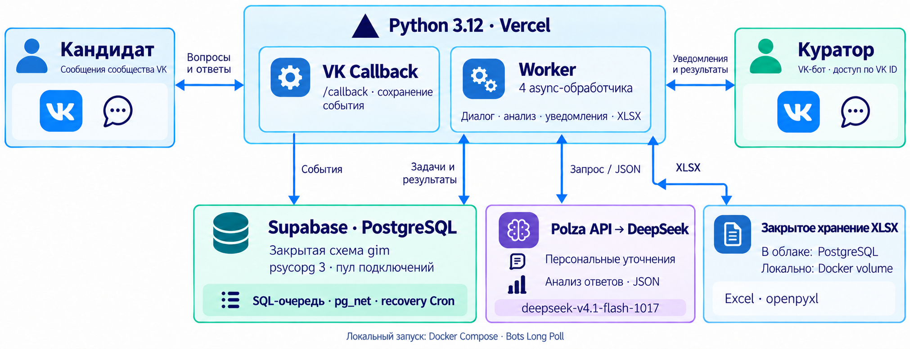

# Волонтёры ГИМ — VK-бот

Кандидат заполняет музейную анкету в VK, получает до трёх персональных уточнений и подаёт заявку. Куратор получает уведомление, предварительную оценку 0–3 с цитатами, резюме, профиль мотивации/опыта/занятости, вопросы для интервью и Excel. Решение о приглашении принимает сотрудник.

**Пользоваться уже запущенным ботом:** [открыть диалог VK](https://vk.me/club242476311) → разрешить сообщения → «Начать». Компьютер разработчика не нужен. [Страница запуска](https://gim-volunteer-bot.vercel.app) · [Кандидату](docs/user-guide.md) · [Администратору](docs/admin-guide.md).

Сообщения сообщества — штатный интерфейс VK-бота. Отдельная пользовательская учётная запись бота не требуется; надпись «Сообщество» задаёт VK.

Актуальный вход VK в облаке проходит через аутентифицированный **Supabase Edge → Vercel Callback**: это устраняет зависимость прямой доставки VK от адреса Vercel. [Причина, реальные замеры и конфигурация](output/CALLBACK_LATENCY_FIX.md).

## Текущая архитектура

Основная ветка — `main`. Python 3.12, PostgreSQL Supabase, закрытая схема `gim`, SQL-очередь, четыре асинхронных обработчика. Redis/ARQ не используются.



**Действующий запуск — облачный Callback.** Альтернатива для собственного сервера — Docker с Long Poll gateway и worker. Выберите один режим для одного сообщества: одновременно запускать облачные обработчики и локальные gateway/worker нельзя.

В облаке XLSX хранится приватно в PostgreSQL (`gim.file_contents`); в Docker — в закрытом volume `shared_files`. Публичного HTTP-скачивания анкет нет. Доступ к БД разделён на роли бота, воркера и сотрудника. Повторы событий отсекаются; задачи используют аренды, ограниченные повторы и проверку актуальной версии ответов.

## Самый простой запуск — Docker, все три ОС

Для **macOS, Linux и Windows** нужен только работающий Docker с Compose v2. Python, PostgreSQL и музейные документы на компьютере не нужны: отдельная БД, роли, музейные вопросы и первый администратор создаются автоматически.

1. Получите репозиторий и скопируйте `.env.quickstart.example` в `.env.quickstart` (`cp` на macOS/Linux, `Copy-Item` в PowerShell).
2. Укажите своё сообщество VK, токен, числовой ID администратора, ключ Polza и случайный пароль PostgreSQL длиной от 24 символов.
3. Выполните одну команду:

```sh
docker compose --env-file .env.quickstart -f compose.quickstart.yaml up --build -d
```

Откройте `https://vk.me/clubВАШ_GROUP_ID` → «Начать». Администратор: `/admin`. База и ответы сохраняются между перезапусками. Используйте отдельное сообщество, чтобы не запускать второй обработчик действующего облачного бота.

**[Полная инструкция Docker для трёх ОС](docs/docker-quickstart.md)** · [Пользователю](docs/user-guide.md) · [Администратору и добавление сотрудников](docs/admin-guide.md) · [Передача проекта ГИМ](docs/transfer-to-gim.md)

## Расширенный запуск: внешняя Supabase или Python

Для следующих вариантов нужны Python 3.12, своё сообщество VK с сообщениями и возможностями ботов, токен сообщества, PostgreSQL/Supabase и ключ Polza. Для Docker нужен Docker Compose; для облака — проект Vercel и Supabase с pg_net, pg_cron и Vault. Исторические анкеты с персональными данными для запуска **не нужны**.

### Linux (Ubuntu / Debian)

Установите Git, Python 3.12 с модулем venv (например, `sudo apt install git python3 python3-venv python3-pip` на Ubuntu 24.04). Проверьте `python3 --version`: нужен Python 3.12. На других дистрибутивах используйте свой менеджер пакетов.

```sh
git clone https://github.com/mchibisov/reu-dsc-hse-hack-gim.git
cd reu-dsc-hse-hack-gim
python3 -m venv .venv
. .venv/bin/activate
python -m pip install -r requirements.shared.txt
python -m pip install -e './database[materials]'
cp .env.example .env
```

### macOS

Установите Git и Python 3.12 с python.org либо через Homebrew (`brew install python@3.12 git`). Затем в Terminal:

```sh
git clone https://github.com/mchibisov/reu-dsc-hse-hack-gim.git
cd reu-dsc-hse-hack-gim
python3.12 -m venv .venv
. .venv/bin/activate
python -m pip install -r requirements.shared.txt
python -m pip install -e './database[materials]'
cp .env.example .env
```

### Windows 10 / 11 (PowerShell, без Docker и WSL)

Установите Git и Python 3.12 с python.org с Python Launcher. Откройте PowerShell:

```powershell
git clone https://github.com/mchibisov/reu-dsc-hse-hack-gim.git
Set-Location reu-dsc-hse-hack-gim
py -3.12 -m venv .venv
.\.venv\Scripts\python.exe -m pip install -r requirements.shared.txt
.\.venv\Scripts\python.exe -m pip install -e './database[materials]'
Copy-Item .env.example .env
```

Активация окружения и изменение ExecutionPolicy не нужны. В дальнейших командах заменяйте `python` на `.\.venv\Scripts\python.exe`. Для Linux/macOS команды ниже выполняются в активированном venv, из корня проекта.

**Новая БД ещё не готова к анкете:** нужны миграции, отдельные LOGIN, первый администратор, музейный банк вопросов и активный набор. Выполните [пошаговую подготовку с нуля](docs/setup-from-scratch.md). Для уже подготовленной БД повторно создавать роли и набор не требуется.

В локальном `.env` заполните:

| Переменная | Значение |
|---|---|
| `VK_TOKEN`, `VK_GROUP_ID` | Токен и числовой ID своего сообщества |
| `RECRUITMENT_ID` | UUID активного набора, полученный при загрузке материалов |
| `DATABASE_BOT_URL`, `DATABASE_WORKER_URL`, `DATABASE_STAFF_URL` | Три разных ограниченных LOGIN; SSL для Supabase, не операторский пароль |
| `LLM_API_KEY` | Ключ Polza |
| `LLM_BASE_URL` | `https://polza.ai/api/v1` |
| `LLM_MODEL` | `deepseek/deepseek-v4.1-flash-1017` |
| `ANALYSIS_RUBRIC_PATH` | `config/ranking-50-35-15.json` для действующей формулы новых анкет |
| `EXCEL_ACCESS_CODE` | Необязательный секрет для отдельной выдачи Excel без роли сотрудника; пустой отключает этот доступ |

Остальные параметры оставьте по `.env.example`. `.env`, операторские подключения, файлы паролей и анкеты не коммитятся. Операторский `DATABASE_ADMIN_URL` нужен только при подготовке БД, не передаётся в рабочие контейнеры или Vercel.

### Локальный запуск без Docker — все три ОС

1. Выполните подготовку БД по ссылке ниже и заполните `.env`. Проще использовать собственный Supabase: локальный сервер PostgreSQL тогда не нужен. Либо установите PostgreSQL 16+ локально, создайте отдельную пустую БД и примените те же миграции/роли. Без банка вопросов, активного набора и трёх DSN бот не запустится.
2. В **своём тестовом сообществе VK** включите сообщения, возможности ботов и Bots Long Poll (`message_new`). Подключите токен и ID этого сообщества в `.env`. Не подключайте локальный бот к сообществу с уже работающим облачным ботом.
3. Проверьте подключения и запустите процесс:

Linux / macOS:

```sh
python -m gim.shared_main check-db
python -m gim.shared_main check-vk
python -m gim.shared_main run
```

Windows PowerShell:

```powershell
.\.venv\Scripts\python.exe -m gim.shared_main check-db
.\.venv\Scripts\python.exe -m gim.shared_main check-vk
.\.venv\Scripts\python.exe -m gim.shared_main run
```

`run` запускает gateway и воркеры вместе. Оставьте терминал открытым; остановка — Ctrl+C. Откройте `https://vk.me/clubВАШ_GROUP_ID`, разрешите сообщения и отправьте «Начать». Администратору предварительно нужна роль из шага bootstrap в [подготовке БД](docs/setup-from-scratch.md). Для проверки пройдите анкету, дождитесь AI-анализа и отправьте `/export` из учётной записи сотрудника. При отсутствии ключа Polza анкета сохраняется, но настоящий AI-анализ не выполняется.

Если `check-db` сообщает об ошибке — проверьте три DSN, применённые миграции и активность `RECRUITMENT_ID`. Если `check-vk` не проходит — проверьте токен, ID и разрешения сообщений/Long Poll. Не публикуйте вывод с секретами.

### Вариант A: Docker / свой сервер с Long Poll

Используйте своё тестовое сообщество либо заранее выполните контролируемое переключение транспорта. В VK включите Long Poll с `message_new`, сообщения и возможности ботов. Сотрудник должен разрешить сообщения сообщества.

```sh
python -m gim.shared_main check-db
python -m gim.shared_main check-vk
docker compose up --build -d
docker compose ps
docker compose logs --tail=100 gateway worker
```

Compose подключается к уже подготовленной внешней PostgreSQL; локальную БД сам не создаёт. Либо для разработки запустите `python -m gim.shared_main run` **вместо** Compose. `check-db` проверяет роли, активный набор и обязательные вопросы; `check-vk` — доступ к VK. Они не заменяют полный тест анкеты и LLM.

### Вариант B: Vercel + Supabase Callback

Полная последовательность — в [инструкции развёртывания](docs/deployment-guide.md). После общей подготовки БД:

1. Разверните `api/index.py` с `vercel.json`, включая `gim/`, `database/src/` и `config/`. Зависимости облака — `requirements.txt`.
2. Задайте production-переменные из таблицы и секреты `VK_CALLBACK_SECRET`, `VK_CONFIRMATION`, `WORKER_DISPATCH_KEY`. Храните их в защищённых переменных проекта.
3. Настройте Supabase Vault, примените `deploy/supabase-dispatch.sql` и включите минутное расписание восстановления. Подробности и команды — в инструкции.
4. Зарегистрируйте в VK Callback URL `https://ВАШ-ПРОЕКТ.vercel.app/callback`, установите совпадающий секрет, подтвердите сервер и включите `message_new`.
5. Проверьте `/health`, затем живую анкету, уведомление и `/export` в VK. `health` сам по себе не проверяет БД/LLM.

В действующем проекте Callback и recovery Cron уже настроены. Автоматическая Git-интеграция Vercel не настроена: push в `main` сам по себе не обновляет облачный код.

## Интерфейс куратора

Роль назначается проверенному VK ID; знание команд не даёт доступа.

| Команда | Действие |
|---|---|
| `/admin` | Меню сотрудника |
| `/new`, `/new 2` | Новые заявки, страницы |
| `/top`, `/top 2` | Рейтинг с краткими AI-сводками |
| `/application UUID` | Карточка, профиль, цитаты и вопросы интервью |
| `/stats`, `/jobs` | Статистика и состояние задач |
| `/export`, `/export UUID` | Excel набора / одной анкеты |
| `/score UUID 2 Обоснование` | Ручная оценка с сохранением исходного AI-результата и аудита |
| `/reset`, затем `/reset confirm` | Только admin: новая собственная тестовая попытка; прежняя архивируется |

XLSX приходит вложением. Пять листов: «Анкеты», «Ответы», «Собеседование», «Сводка», «Оценка». Есть фильтры, закрепления, переносы, числовой рейтинг, полные ответы, AI-уточнения и доказательства. Длинные значения продолжаются на следующих строках.

Скрытый `/excel КОД` даёт право только на одну выгрузку, не административную роль. Код не включается в обычное меню, удаляется до записи события в очередь; после пяти неверных попыток действует ограничение на 10 минут. Перед доставкой доступ проверяется повторно. При ротации кода обновите production env и deployment либо перезапустите локальные процессы.

## Оценивание и ограничения

Для новых анкет используется заданная пользователем формула **50% мотивация / 35% опыт / 15% обучение и нагрузка**. DeepSeek извлекает фиксированные факты и цитаты; сервер проверяет цитаты и вычисляет дробный рейтинг S и округлённый балл 0–3. Веса не утверждены музеем. Неизвестные сведения не объявляются отсутствием навыков. Окончательное решение принимает сотрудник.

Старые анкеты сохраняют закреплённые рубрики и результаты. Экспериментальный обученный классификатор не внедрён: на независимых 22 анкетах он не превысил majority baseline. Независимая точность новой формулы не доказана. [Метрики и ограничения](docs/evaluation-report.md).

При отказе LLM анкета сохраняется, оценка остаётся отсутствующей; после окончательного отказа задачи уведомляется сотрудник. Уточнения могут браться из музейной библиотеки. Модель не получает ключи или доступ к БД; контакты исключаются/маскируются, но свободный текст не гарантированно обезличен полностью.

## Проверка и эксплуатация

Последняя проверка: **220 pytest прошли** на отдельной PostgreSQL. Текущая 18-вопросная версия развёрнута в Vercel; сохранность прежних ответов/оценок проверена. Полная API-цепочка с настоящими Polza, Supabase, VK-уведомлениями и скачанным XLSX проверена. Шесть команд доставлены за **0,85–2,20 сек**. [Финальная проверка и ограничения](output/FINAL_REVIEW.md).

Локальные проверки без БД:

```sh
python -m unittest discover -s tests -q
```

Для интеграционных тестов используйте **отдельную одноразовую PostgreSQL**. Установите тестовые зависимости, примените к ней миграции по [инструкции](docs/setup-from-scratch.md), задайте `TEST_DATABASE_URL` и запускайте:

```sh
python -m pip install -e './database[test,materials]'
python -m pytest -q
```

Для Windows замените `python` на `.\.venv\Scripts\python.exe`, включая команды в руководстве подготовки БД; переменные окружения задавайте через `$env:ИМЯ = 'значение'`. Никогда не направляйте тесты на рабочую БД. В операторских командах не печатайте и не сохраняйте пароли в истории.

Для постоянной эксплуатации нужны контроль квот/баланса, регулярные внешние резервные копии и согласованные музеем правила хранения/удаления персональных данных. Бесплатный хостинг не означает гарантии бессрочной бесплатной работы. Автоматическое полное удаление данных и просмотр VK-профиля не реализованы; `/delete` направляет к оператору. PDF и отдельный веб-кабинет не входят в выпуск.

[Итоговый статус](output/FINAL_STATUS.md) · [Сверка QA](output/REQUIREMENTS_AUDIT.md) · [Оценка по критериям](output/JURY_ASSESSMENT.md) · [Киллерфичи](output/KILLER_FEATURES.md) · [Демо](docs/demo-guide.md) · [Безопасность](docs/security-review.md).

## Сохранённая работающая версия

До очистки и изменения анкеты сохранена [«Работающая версия»](https://github.com/mchibisov/reu-dsc-hse-hack-gim/tree/working-version-2026-10-22), commit 7d06b60. Старый public-runtime и его инструкции доступны в этой метке; текущая ветка содержит только private PostgreSQL runtime.

Анкета содержит 18 основных вопросов; «ВУЗ (Другое)» исключён, «Факультет, направление» — одно поле. Миграция `20261022030000_questionnaire_revision.sql` уже применена к действующему облаку. Для обновления другой существующей установки временно приостановите запуск обработчиков, сохранив Callback и очередь, дождитесь старых workers, примените миграцию, обновите код и возобновите обработку. Старые ответы не удаляются.

### Скорость ответов и оформление

Основные 18 вопросов и проверка ожиданий идут без LLM. После них персональное AI-уточнение ждёт максимум 3 секунды, затем бот использует подготовленный вопрос. Анализ анкеты выполняется в фоне после её завершения; reasoning выключен. Воркер дожидается ближайших повторов доставки, чтобы сетевой сбой не оставлял сообщение до минутного Cron.

Замеры реальной доставки команд: **0,83–2,44 с** в шести проверках; внешние API могут задерживаться. [Подробности исправления](output/LATENCY_FIX_2026-10-22.md). [Аватарка и приветственные картинки](assets/branding/README.md).
